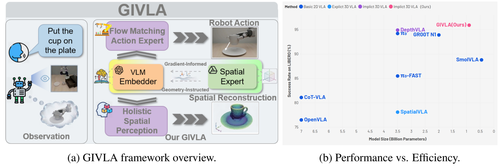
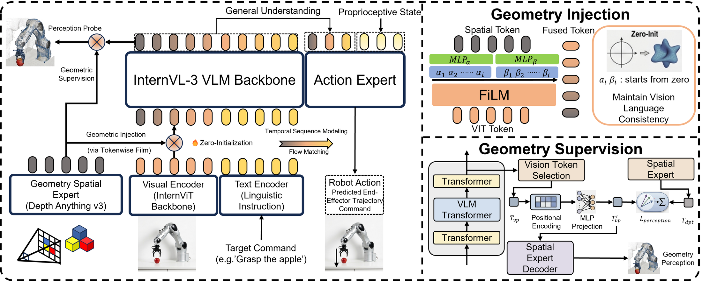
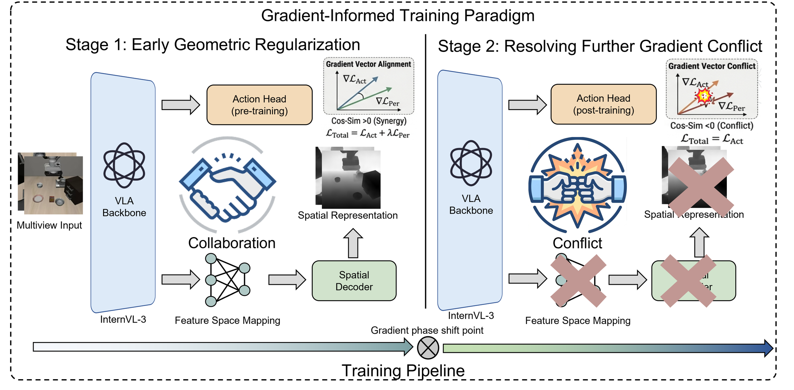

<div align="center">

# GIVLA

### Deep Geometry Internalization for A Lightweight VLA<br>via Geometry Instruction and Gradient-Informed Training

**NeurIPS 2026**

Yunhe Li\*, Qiming Liu\*, Haoyuan Wang\*, Hesheng Wang†<br>
School of Automation and Intelligent Sensing, Shanghai Jiao Tong University<br>
<sub>\* Equal contribution. † Corresponding author.</sub>

[**Code**](https://github.com/Alexander-bugwriter/GIVLA) ·
[**Model checkpoint**](https://huggingface.co/Alexander-bugwriter/GIVLA) ·
[**Conference page**](https://neurips.cc/virtual/2026/poster/152891)



**0.9B parameters · 95.90% LIBERO average success · 68.95% LIBERO-plus macro-average success**

</div>

## Overview

**GIVLA** couples a geometric expert with a lightweight vision-language-action model. It injects geometric features into the VLM through token-wise FiLM modulation and uses early geometry alignment to support action learning. A two-stage training schedule then removes geometry supervision for action refinement, while keeping geometry injection active.

The model uses **InternVL3**, **Depth Anything v3**, and a **Flow Matching action head**. We evaluate it on LIBERO, LIBERO-plus under distribution shifts, and real manipulation tasks on an AgiBot G1 robot.

<p align="center">
  
</p>

<p align="center">
  
</p>

## Environment setup

The training and inference commands below target a Linux environment with an NVIDIA GPU. LIBERO evaluation uses a separate environment to accommodate its simulator dependencies.

### GIVLA environment

```bash
git clone https://github.com/Alexander-bugwriter/GIVLA.git
cd GIVLA

conda create -n GIVLA python=3.10 -y
conda activate GIVLA
pip install -r requirements.txt
MAX_JOBS=64 pip install -v flash-attn --no-build-isolation

cd model/depth_anything_v3
pip install -e .
cd ../..
```

<details>
<summary>Optional dependency for the DA3 Gaussian head</summary>

If using the DA3 Gaussian head, install the dependency provided in the original setup instructions:

```bash
pip install --no-build-isolation git+https://github.com/nerfstudio-project/gsplat.git@0b4dddf04cb687367602c01196913cde6a743d70
```

</details>

### Dataset configuration

Prepare LIBERO data in the LeRobot format expected by the dataset loader, then update the dataset paths in [`dataset/config.yaml`](dataset/config.yaml) to match your local files. The configuration includes Spatial, Object, Goal, and Long (`libero_10`) suites.

Keep the configured maximum action dimension, state dimension, and number of views consistent with the model. The supplied configuration uses `24`, `24`, and `3`, respectively. LIBERO observations and actions are padded or masked to these dimensions by the evaluation adapter.

## Model checkpoint

The checkpoint download link is [Alexander-bugwriter/GIVLA](https://huggingface.co/Alexander-bugwriter/GIVLA).

The current inference loader expects the following files in the same checkpoint directory:

```text
<checkpoint_directory>/
├── config.json
├── norm_stats.json
└── mp_rank_00_model_states.pt
```

Set `ckpt_dir` in [`scripts/GIVLA_server.py`](scripts/GIVLA_server.py) to the directory containing these files. Use the configuration and normalization statistics corresponding to the checkpoint. The checkpoint is stored in a DeepSpeed model-state format rather than a standalone Transformers model directory.

## Training commands

Run all commands from the repository root in the `GIVLA` environment. Configure Accelerate before training:

```bash
conda activate GIVLA
accelerate config
```

### Stage 1: Geometry alignment

```bash
accelerate launch \
  --num_processes 1 \
  --num_machines 1 \
  --use_deepspeed \
  --deepspeed_config_file ds_config.json scripts/finetune_align.py \
  --run_name GIVLA_stage1 \
  --da3_film_in \
  --SF_align \
  --align_loss_alpha 0.5 \
  --action_head flowmatching \
  --use_augmentation \
  --lr 2.5e-5 \
  --dropout 0.2 \
  --weight_decay 1e-3 \
  --batch_size 8 \
  --image_size 448 \
  --max_steps 4000 \
  --log_interval 10 \
  --ckpt_interval 1000 \
  --warmup_steps 1000 \
  --grad_clip_norm 1.0 \
  --num_layers 8 \
  --horizon 50 \
  --finetune_action_head \
  --finetune_dpt_linear_film \
  --finetune_SF_align \
  --disable_wandb \
  --vlm_name OpenGVLab/InternVL3-1B \
  --dataset_config_path dataset/config.yaml \
  --per_action_dim 24 \
  --state_dim 24 \
  --save_dir model_checkpoint/GIVLA/stage_1
```

### Stage 2: Action refinement

```bash
accelerate launch \
  --num_processes 1 \
  --num_machines 1 \
  --use_deepspeed \
  --deepspeed_config_file ds_config.json scripts/finetune_align.py \
  --run_name GIVLA_stage2 \
  --da3_film_in \
  --action_head flowmatching \
  --use_augmentation \
  --lr 1e-5 \
  --dropout 0.2 \
  --weight_decay 1e-3 \
  --batch_size 8 \
  --image_size 448 \
  --max_steps 150000 \
  --log_interval 10 \
  --ckpt_interval 2500 \
  --warmup_steps 1000 \
  --grad_clip_norm 1.0 \
  --num_layers 8 \
  --horizon 50 \
  --finetune_action_head \
  --finetune_dpt_linear_film \
  --finetune_da3 \
  --finetune_vit \
  --finetune_llm_backbone \
  --disable_wandb \
  --vlm_name OpenGVLab/InternVL3-1B \
  --dataset_config_path dataset/config.yaml \
  --per_action_dim 24 \
  --state_dim 24 \
  --save_dir model_checkpoint/GIVLA/stage_2 \
  --resume \
  --resume_pretrain \
  --resume_path model_checkpoint/GIVLA/stage_1/step_4000
```

Stage 2 resumes the `step_4000` checkpoint produced by Stage 1. Adjust `--resume_path` if using another output directory. The Stage-1 command above uses the paper's 4,000-step transition; the 5,000-step diagnostic run in the gradient analysis is a separate setup.

<details>
<summary>Accelerate configuration for a single GPU with DeepSpeed</summary>

| Prompt | Setting |
| --- | --- |
| Number of machines | `1` |
| Distributed-operation checks | `no` |
| Torch Dynamo | `no` |
| Use DeepSpeed | `yes` |
| Use a DeepSpeed JSON configuration | `yes` |
| DeepSpeed configuration path | Absolute path to [`ds_config.json`](ds_config.json) |
| ZeRO Stage-3 initialization | `no` |
| Mixture-of-Experts training | `no` |
| Number of GPUs | `1` |

</details>

## Evaluation

### LIBERO environment

From the GIVLA repository root:

```bash
conda create -n libero python=3.8.13 -y
conda activate libero

cd LIBERO_Evaluation
git clone https://github.com/Lifelong-Robot-Learning/LIBERO.git
cd LIBERO
pip install -r requirements.txt
pip install torch==1.11.0+cu113 torchvision==0.12.0+cu113 torchaudio==0.11.0 --extra-index-url https://download.pytorch.org/whl/cu113
pip install -e .
pip install websockets huggingface_hub
```

### Start the inference server

In one terminal, return to the **GIVLA repository root**, select the downloaded checkpoint by editing `ckpt_dir`, and start the server:

```bash
conda activate GIVLA
python scripts/GIVLA_server.py
```

### Run the LIBERO client

In another terminal, return to the **GIVLA repository root**. Set `Args.SERVER_URL` in the client to match the inference server. For a local server using its current default port (`8000`), use:

```python
SERVER_URL = "ws://127.0.0.1:8000"
```

Then run:

```bash
conda activate libero
cd LIBERO_Evaluation
python libero_client_4tasks.py
```

## Citation

```bibtex
@inproceedings{li2026givla,
  title={GIVLA: Deep Geometry Internalization for A Lightweight VLA via Geometry Instruction and Gradient-Informed Training},
  author={Li, Yunhe and Liu, Qiming and Wang, Haoyuan and Wang, Hesheng},
  booktitle={Advances in Neural Information Processing Systems},
  year={2026}
}
```

## Acknowledgments

GIVLA builds on [InternVL3](https://github.com/OpenGVLab/InternVL), [Depth Anything v3](model/depth_anything_v3), and [LIBERO](https://github.com/Lifelong-Robot-Learning/LIBERO). We thank their authors for making these resources available. See [LICENSE](LICENSE) for the repository license.

